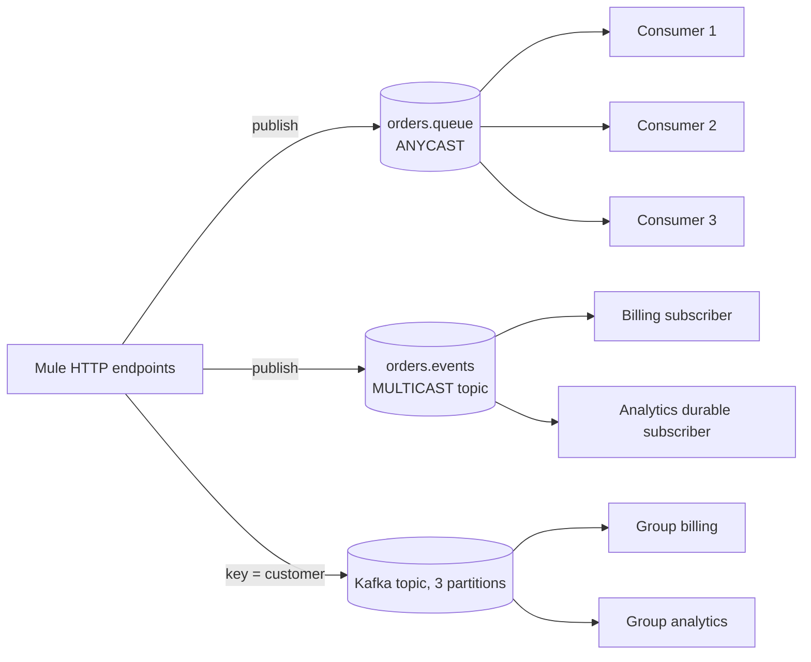

# Messaging Patterns on Mule 4

Hands-on flows that compare how Mule 4 works with two message brokers: **JMS on ActiveMQ Artemis** and **Apache Kafka**. Each flow is small and isolates one behaviour (acknowledgement mode, ordering, transactions, offsets), with a comment in the file saying what it proves and what the Anypoint MQ equivalent would be.

## What it demonstrates

**JMS (`src/main/mule/jms/`)**

| Topic | Files | Shows |
|---|---|---|
| Queue basics | `lab1-jms-basic`, `lab1-jms-consume` | Publish to a queue, persistent vs non-persistent, listener, competing consumers (`numberOfConsumers`) |
| Request-reply | `lab1-jms-request-reply` | Synchronous reply over a temporary queue |
| Topics | `lab1-jms-topic` | Publish-subscribe, non-durable (billing) vs durable (analytics) subscribers |
| Acknowledgement | `lab2-jms-ack*` | AUTO, IMMEDIATE, MANUAL and DUPS_OK, and what each does when processing fails after the message was received |
| Idempotent consumer | `lab3-jms-idempotent` | Repeated deliveries made harmless |
| Ordering | `lab3-jms-ordering` | Message order with one and several consumers |
| Transactions | `lab3-jms-transaction` | Transacted JMS listener: commit and rollback |

**Kafka (`src/main/mule/kafka/`)**

| Topic | Files | Shows |
|---|---|---|
| Publish | `kafka-publish`, `kafka-bulk` | Key-based partitioning, explicit partition, bulk publish |
| Consume | `kafka-consume` | Consumer group, auto commit |
| Offset control | `kafka-immediate`, `kafka-manual` | Commit before processing vs commit after success |
| Replay | `kafka-history`, `kafka-seek` | Read from EARLIEST with a new group; move a consumer to an offset while running |

## Topology



## Design decisions and trade-offs

- **Queue to share work, topic to fan out.** Several consumers on one queue split the messages and none is processed twice, but order is not kept. A topic gives every subscription its own copy.
- **Persistent delivery for anything that matters.** A persistent message survives a broker restart because it is written to the journal; a non-persistent one is faster but lost. The default in the Mule JMS connector is non-persistent.
- **Order needs a key.** With several consumers or a retry delay, order breaks. Grouping by order id (`JMSXGroupID`) restores it per order. Trade-off: a failing message stalls the messages of its own group.
- **Acknowledgement mode decides what a failure means.** AUTO acknowledges on success and redelivers on a propagated error, IMMEDIATE acknowledges before processing so a failure cannot be undone, MANUAL puts the decision in the flow, DUPS_OK allows duplicates.
- **Kafka partitions by key.** The same key always lands in the same partition, so order holds per key and not across keys. Each consumer group keeps its own offsets, so groups replay independently.
- **Commit after success for Kafka, with idempotent handling.** Committing before processing can lose messages; committing after can repeat them, so consumers must tolerate repeats.

## Verified behaviour

| Behaviour | Observed |
|---|---|
| Persistence | After a broker restart only the persistent message remained in the queue; the non-persistent one was lost |
| Competing consumers | 6 orders, 3 consumers: each order consumed exactly once, two batches of three on three different threads |
| Topic with two subscribers | Billing and Analytics both received the same event with the same correlation id |
| Durable subscription | Analytics, restarted after being offline, received the two events published while it was down |
| Ordering, 1 consumer, one message fails once | Finish order 1,2,3,4,5; the failed message stalled the ones behind it |
| Ordering, 3 consumers, same failure | Finish order 2,1,4,5,3: parallel consumers and the retry delay broke order |
| Ordering, 3 consumers with `JMSXGroupID` = order id | Order restored for each order (1,2,3,4,5); group ids equal the order id on all six events |
| Kafka keys | Nine keys sent twice: every key stayed in one partition both times |
| Kafka consumer group | Each message went to exactly one consumer in the group; a 4th consumer stayed idle; stopping an active one moved its partition to the idle one, which resumed at the committed offset |
| Kafka groups are independent | Billing and analytics each read all messages and kept their own offsets |
| Kafka replay | Resetting the offset to earliest (group stopped) made the consumer re-read all 9 messages |

## Layout

```
src/main/mule/global/   shared JMS, Kafka and HTTP configs
src/main/mule/jms/      JMS labs 1-3
src/main/mule/kafka/    Kafka flows
docker-compose.yml      Artemis and Kafka brokers
```

## Endpoints

JMS: `POST /orders`, `/orders-persistent`, `/orders-request-reply`, `/order-events`, `/orders-ack`, `/orders-ack-propagate`, `/orders-ack-immediate`, `/orders-ack-manual`, `/orders-ack-dups-ok`, `/orders-idem`, `/orders-seq`, `/orders-tx`.
Kafka: `POST /orders-kafka`, `/orders-kafka-bulk`, `/orders-kafka-immediate`, `/orders-kafka-manual`, `/kafka-seek`.

## Run it locally

Needs Java 17, Docker and a Mule 4.12 runtime (Anypoint Code Builder or Studio).

```
docker compose up -d        # Artemis (console http://localhost:8161) and Kafka (localhost:9092)
```

Run the Mule app (port 8081 by default), then for example:

```
curl -X POST http://localhost:8081/orders -H "Content-Type: application/json" \
  -d '{"orderId":"A-1","amount":25}'
```

## Security notes

The brokers are local lab containers with default development credentials (`artemis` / `artemis`, Kafka plaintext). They are not reachable beyond your machine and nothing here is a real secret. Do not reuse them anywhere else.
